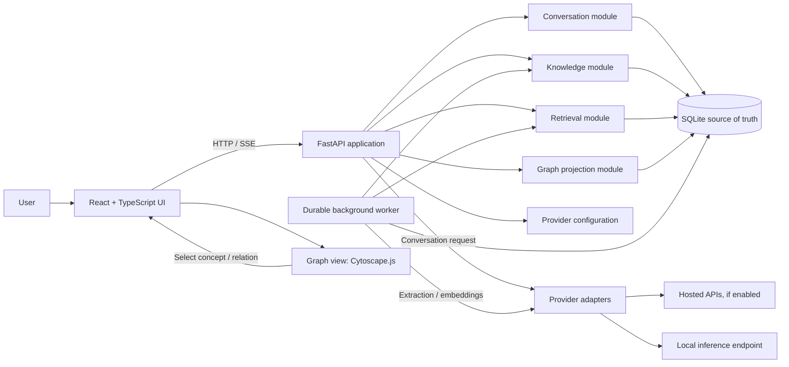

# System architecture

## 1. Recommended shape

Start with a **local-first modular monolith**: one React application and one FastAPI process backed by a local SQLite database. The API process owns domain rules and database writes. A durable database-backed worker loop handles extraction and embedding jobs. AI providers are external adapters invoked only from backend services. There are no microservices, separate graph database, message broker, or cloud requirement in the prototype.

This choice follows the current assumption that one person uses the application locally. If the product becomes hosted or synchronizes data across devices, a PostgreSQL deployment is the likely next architecture; that change is a product/deployment decision, not an automatic scale-up switch.

## 2. Component diagram



The graph view is a client-side projection and interaction surface; it is not a separate data store. The knowledge module owns canonical concept and relation changes. The graph projection module shapes a bounded view model from those records.

## 3. Module responsibilities

| Module | Owns | Must not own |
|---|---|---|
| Conversations | Conversations, messages, turn state, assistant generation lifecycle | Knowledge truth or graph layout |
| Knowledge | Concepts, aliases, mentions, annotations, user states, relations, suggestions, evidence, events | Provider-specific HTTP code |
| AI gateway | Provider/model configuration and normalized chat, embedding, extraction calls | Domain writes and user-state decisions |
| Extraction | Prompt/input assembly, structured extraction validation, deduplication candidates, job lifecycle | Direct UI presentation |
| Retrieval | Lexical/vector candidate search, graph expansion, ranking, context budget | Generating conversation content |
| Graph projection | Depth/budget/filter/time-slice query and graph DTO construction | Persisting a second graph copy |
| API | Authentication boundary (single local owner initially), request validation, response shapes, streaming | Domain rules duplicated from modules |
| Persistence | SQLAlchemy models, migrations, transaction and repository operations | AI policy or interaction rules |
| Worker | Durable job claiming, retry, leases, backoff, shutdown/restart behavior | Long-running hidden work without status |

In a small codebase these are Python packages/modules, not separately deployed processes. Domain services should coordinate writes and events so database invariants do not depend on which endpoint was called.

## 4. Conversation and extraction data flow

```mermaid
sequenceDiagram
  actor User
  participant UI as React UI
  participant API as FastAPI
  participant DB as SQLite
  participant Ret as Retrieval
  participant Model as Chat provider
  participant Worker as Background worker
  participant Ext as Extraction model
  User->>UI: Send message
  UI->>API: POST turn (idempotency key)
  API->>DB: Save user message + pending generation run
  API->>Ret: Build bounded personal context
  Ret->>DB: Hybrid search + graph/evidence expansion
  Ret-->>API: Ranked evidence with source IDs
  API->>Model: System prompt + current turn + selected context
  Model-->>API: Stream answer
  API-->>UI: SSE tokens and completion
  API->>DB: Save assistant message + complete run + enqueue extraction
  API-->>UI: Turn complete; extraction status pending
  Worker->>DB: Claim durable extraction job
  Worker->>Ext: Extract structured candidates
  Ext-->>Worker: Concepts, mentions, relation candidates, signals
  Worker->>DB: Validate, resolve, persist evidence/events/suggestions
  UI->>API: Refresh knowledge status / graph
```

The external model call must not be wrapped in a database transaction. The user message and a pending generation record are committed first; the assistant response is then committed with a completion state. A failed model call leaves the user's message intact and records a retryable/failed turn. API idempotency keys prevent a network retry from duplicating a message or starting two generations.

Extraction is enqueued in the same transaction that saves the assistant message and marks the turn complete. This avoids the failure window where the conversation is saved but the extraction task is lost. The worker is a lightweight loop over durable rows in SQLite; a crash returns an expired lease to the queue. Job handlers use a stable idempotency key based on source turn plus extractor version.

## 5. Asynchronous processing and database writes

For the local prototype, run one worker process (or one worker loop in the service process) and keep each write transaction short. SQLite in WAL mode permits readers alongside a writer, but concurrent writes still serialize; the worker must batch or sequence writes and never hold a transaction while waiting for a model. The official SQLite documentation describes WAL as allowing readers and a writer to proceed concurrently, while retaining database-level limitations around the writer. [SQLite WAL](https://sqlite.org/wal.html)

The durable `background_jobs` row should contain: job kind, source turn, status, attempt count, availability time, lease owner/expiry, last error category, idempotency key, and timestamps. Extraction-specific model/prompt/schema details live in an `extraction_runs` provenance row. Retry transient provider/network failures with bounded exponential backoff. Validation failures should be marked failed and surfaced for diagnostics, not retried forever. Jobs must be safe to execute more than once.

Use a worker abstraction rather than importing a queue product now. If throughput or service uptime later needs independent scaling, the same job contract can move to a broker-backed worker, while the source conversation and knowledge tables remain authoritative.

## 6. Retrieval data flow

At turn start, retrieval receives the current message and conversation metadata. It:

1. searches full-text indexes for exact terms and named concepts;
2. searches message-chunk embeddings for semantic similarity, where embeddings exist;
3. retrieves relevant concepts, user-established relations, open questions, and pending user annotations through relational/graph queries;
4. merges and deduplicates candidates, prioritizing recent, directly relevant, user-authored, and explicitly marked evidence;
5. applies a strict item and token budget and retains source IDs for attribution;
6. returns a context bundle to the conversation provider.

Retrieved text is evidence for an answer, not instruction. Treat stored messages and model-generated text as untrusted context; delimit it and instruct the model to use it as reference. The UI can expose “used prior context” with links to the supporting messages. The retrieval module never turns a retrieved relation into a personal belief.

## 7. Knowledge extraction flow

The extractor receives the completed turn (user and assistant messages), known concepts/aliases in the local neighborhood, and explicit annotations. It returns a schema-validated proposal containing:

- concept mentions anchored to exact message spans;
- candidate concept creations/alias matches;
- user-asserted relations only when the user actually expresses them;
- AI-suggested relations separately;
- explicit annotations as already persisted UI actions, not regenerated model output;
- optional inferred learning signals with source role, text span, rationale, and low-authority status;
- source-grounded conceptual claims for the world-claim ledger only where useful.

Before writes, the knowledge service resolves normalized aliases and checks possible duplicates. It should prefer attaching a mention to a known concept when confidence is strong, otherwise create an unresolved candidate for review or preserve an unlinked mention. It must not merge concepts solely because embeddings are close. Every accepted extraction creates evidence and a `knowledge_event`; user-confirmation actions create separate events.

## 8. Provider integration

Use a small provider protocol with operations such as `complete_chat`, `stream_chat`, `create_embeddings`, and optionally `extract_structured`. A provider adapter translates provider-specific request and response formats into application types. A model registry/configuration selects a provider and model by task (`conversation`, `extraction`, `embedding`); role separation is configuration, not a requirement to deploy three models.

Persist provider, model identifier, model parameters that affect output, prompt/schema version, and request/response status with generation and extraction records. Do not store secret API keys in ordinary database rows or send them to the frontend. Local providers use the same interface with a loopback endpoint and user-managed model process; hosted adapters use remote API credentials and must expose the data-transfer boundary in settings.

Avoid an abstraction so broad that it erases useful provider capability. The application needs a stable minimal contract and a provider capability record (streaming, JSON/schema output, embeddings, context limit), with feature checks at call time. Provider-specific options can be namespaced in configuration, not leaked into domain entities.

## 9. Frontend and desktop portability

React + TypeScript + Vite are a reasonable UI foundation. Keep API clients, state, and view components independent from browser-specific deployment assumptions. TanStack Query can own server state and cache invalidation; local component state or Zustand can handle transient UI state. Avoid storing the knowledge graph as an independent long-lived client truth; reload it from graph API projections after state changes.

For a later Tauri application, reuse the frontend bundle and domain API. Package the backend and database as a local sidecar/service or migrate core domain services to a native process behind a stable local API. Decide packaging, process lifecycle, and secret storage before committing to a desktop security model. Tauri does not remove the need to treat model keys, local API origins, and imported content carefully.

## 10. Technology assessment

| Concern | Recommendation for the first prototype | Rationale / condition to revisit |
|---|---|---|
| Frontend | React + TypeScript + Vite | Fits a browser-first product and can be packaged later. Keep graph-specific components isolated. |
| UI components | Tailwind + shadcn/ui optional | Useful for rapid accessible primitives; keep product-specific interaction semantics in app code. |
| Client state | TanStack Query for server state; local state first, Zustand only if shared transient state grows | Avoid overlapping sources of truth. |
| Backend | Python + FastAPI | Good fit for AI/provider ecosystem and typed HTTP APIs. Keep domain code framework-independent. |
| Validation | Pydantic on API/domain boundaries; generated OpenAPI client or shared schema generation where practical | Avoid hand-maintaining the same wire types in Pydantic and Zod. Zod remains useful for frontend-only form validation. |
| ORM/migrations | SQLAlchemy + Alembic | Suitable for a relational model and database evolution; explicitly test SQLite-specific migrations. |
| Database | SQLite initially, under the assumptions in ADR-1 | Local ownership and one user; no DB server. Move when deployment needs justify cost. |
| Search | SQLite FTS5 plus exact vector scan for the early corpus | Keeps initial install simple and ranking exact. Measure before adding extension/index complexity. |
| Graph store | Relational tables and indexed joins | The graph is user-sized and needs provenance, transactions, and history more than open-ended path-query optimization. |
| Visualization | Cytoscape.js for the first graph view | Browser graph rendering, selectors, events, extensible layouts, and analysis fit a bounded interactive graph; isolate behind a graph-view adapter. |
| Desktop | Preserve an HTTP/domain boundary; consider Tauri when there is a tested web workflow | Desktop packaging is a later deployment choice, not a reason to introduce a second client now. |

The chosen database is an explicit local-first assumption. PostgreSQL is preferable from the start if the first shipped product must be remotely hosted, multi-user, or synchronized across devices. PostgreSQL provides built-in full-text search and `jsonb`; pgvector adds exact and approximate vector search within the database. Approximate indexes trade recall for speed and require measurement/tuning, so they are not automatically beneficial for a small personal corpus. [PostgreSQL JSON types](https://www.postgresql.org/docs/current/datatype-json.html), [pgvector](https://github.com/pgvector/pgvector)

## 11. Security and privacy boundaries

- Bind local server endpoints to loopback by default; do not expose an unauthenticated local API on the network.
- Protect browser access with an origin/CSRF strategy appropriate to the local deployment; validate allowed origins and reject arbitrary hosts.
- Keep provider secrets in OS-backed secret storage where available, or a protected local configuration file with clear limitations; redact them from logs.
- Log identifiers and error categories, not full prompts or private message content by default.
- Make remote provider use visible. Send only context selected for the current task and configured provider.
- Validate imports and exported archives; escape all rendered message content.
- Restrict local inference endpoints to configured addresses and protect against server-side request forgery through user-entered endpoints.
- Provide deletion that removes derived FTS rows, embeddings, suggestions, and evidence when source content is deleted.

## 12. Failure behavior

- **Chat provider fails:** preserve user message, mark generation failed/retryable, and show a clear retry action.
- **Extraction provider fails:** leave the conversation intact, retain queued/failed state, and retry with backoff.
- **Malformed structured output:** validate; attempt one bounded repair if supported; otherwise persist failure metadata, no partial graph writes.
- **Embedding provider unavailable:** lexical search and graph queries still work; embeddings can be backfilled later.
- **SQLite busy/locked:** retry only short idempotent database operations with a bounded delay; do not blindly replay provider calls.
- **Graph exceeds display budget:** return a focused neighborhood with a summary count and offer narrower filters; do not render the entire relation set by default.
