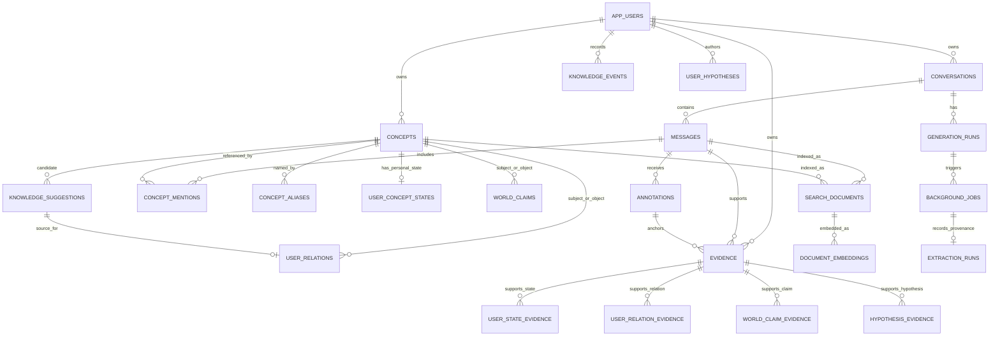

# Data model

## 1. Modeling goals

The database must keep four things distinct:

1. **Source material:** conversations, messages, annotations, and imported sources.
2. **Concept identity:** what a concept is called and the messages that mention it.
3. **World claims:** claims about relationships in the conceptual landscape, each with its own provenance and epistemic status.
4. **Personal knowledge:** evidence that the user encountered/explored a concept, their self-reports, demonstrations, and relations they themselves established.

An AI suggestion is a fifth kind of record. It may point to a possible relation between concepts but is not a personal relation until the user directly asserts or accepts it. Events preserve changes; current state tables support ordinary reads. This is a relational model rather than an attempt to store the whole product in JSON or in a graph database.

## 2. Conceptual model and ER diagram



The diagram omits some owner foreign keys and the event's optional references for readability. All user-owned records carry an owner/user key or are reachable only through an owned parent, with database constraints where practical.

In the local prototype, world claims are stored in the user's workspace so their sources and retrieval history remain owned/exportable with the rest of the data. They are conceptually separate from personal understanding, but this is not a globally shared encyclopedia or canonical ontology.

## 3. Relational schema proposal

### 3.1 Identity and conversation

| Table | Important columns | Constraints / purpose |
|---|---|---|
| `app_users` | `id`, `created_at`, `display_name` | One local principal row initially. No login/auth tables until a hosted product exists. |
| `conversations` | `id`, `owner_user_id`, `title`, `created_at`, `updated_at`, `archived_at` | FK owner; index by `(owner_user_id, updated_at DESC)`. Title may be generated but editable. |
| `messages` | `id`, `conversation_id`, `sequence_no`, `role`, `content`, `created_at`, `reply_to_message_id`, `provider`, `model`, `content_hash` | Unique `(conversation_id, sequence_no)`; role check `user|assistant|system`; immutable body after storage. Assistant messages retain model provenance. |
| `generation_runs` | `id`, `conversation_id`, `user_message_id`, `assistant_message_id`, `status`, `provider`, `model`, `prompt_version`, `idempotency_key`, `error_code`, timestamps | Idempotency key unique per owner; status `pending|running|succeeded|failed|cancelled`; failed run can be retried without duplicating user message. |

### 3.2 Concepts and their mentions

| Table | Important columns | Constraints / purpose |
|---|---|---|
| `concepts` | `id`, `owner_user_id`, `canonical_name`, `normalized_name`, `description`, `created_at`, `updated_at`, `merged_into_concept_id`, `archived_at` | Unique `(owner_user_id, normalized_name)` for canonical names; `merged_into` self-FK; a merge redirects references then preserves old ID as an alias/tombstone. No `understood` boolean. |
| `concept_aliases` | `id`, `concept_id`, `alias`, `normalized_alias`, `origin`, `created_at` | Origin `user|extractor|import`; multiple matching aliases may be allowed to preserve homonyms; resolver handles ambiguity. |
| `concept_mentions` | `id`, `concept_id`, `message_id`, `start_offset`, `end_offset`, `offset_unit`, `surface_text`, `resolution`, `created_at`, `extraction_run_id` | FK concept/message; offset pair both null or valid `0 <= start < end`; offsets use Unicode code points against immutable message text. Resolution `explicit|resolved|candidate`. Each row ties concept use to evidence. |
| `annotations` | `id`, `message_id`, `owner_user_id`, `tag`, `start_offset`, `end_offset`, `offset_unit`, `selected_text`, `origin`, `created_at`, `removed_at` | Tag enum initially: `aha|confused|question|connection|hypothesis|revisit|important`; origin is always `user_explicit`. Multiple annotations/spans per message are valid. Inferred signals live in `user_state_evidence` as candidates, not in the user's annotation stream. |

Keep concept identity sparse: a concept row is a stable handle, not a claim that every property of the concept is known. Source-dependent definitions or relations belong in world claims with evidence.

### 3.3 World model, personal model, and suggestions

| Table | Important columns | Constraints / purpose |
|---|---|---|
| `world_claims` | `id`, `owner_user_id`, `subject_concept_id`, `predicate`, `object_concept_id`, `claim_text`, `polarity`, `status`, `source_kind`, `confidence_hint`, `created_at`, `valid_from`, `supersedes_claim_id` | `source_kind`: `assistant_message|user_source|curated`; `status`: `provisional|supported|challenged|superseded`. Optional confidence hint is qualitative (`low|medium|high`) and model-scoped. A model assertion starts provisional. This is a sourced claim ledger, not ground truth. |
| `user_concept_states` | `owner_user_id`, `concept_id`, `first_encountered_at`, `last_explored_at`, `self_assessment`, `demonstration_status`, `updated_at` | PK `(owner_user_id, concept_id)`. Self-assessment `unknown|confused|uncertain|self_reports_understanding`; demonstration `none|some_evidence|repeated_evidence|contradictory_evidence`. No numeric mastery score. |
| `user_relations` | `id`, `owner_user_id`, `subject_concept_id`, `predicate`, `object_concept_id`, `origin`, `established_at`, `withdrawn_at`, `supersedes_relation_id`, `source_suggestion_id` | Relation status is current by `withdrawn_at`/supersession; origin `direct_user_assertion|accepted_suggestion|explicit_annotation`. `source_suggestion_id` is an optional FK to the accepted suggestion. It means the user has established this connection, not that the system has proven mastery. |
| `knowledge_suggestions` | `id`, `owner_user_id`, `suggestion_type`, `subject_concept_id`, `predicate`, `object_concept_id`, `explanation`, `confidence_hint`, `status`, `extraction_run_id`, `created_at`, `resolved_at` | Type initially `connection`; status `pending|accepted|rejected|dismissed`. Accept creates a `user_relations` row pointing back to this suggestion; reject remains recorded. Confidence is a review hint, not probability. |

`user_hypotheses` are user-attributed propositions, not world claims. A tagged hypothesis can start as `active`; later support/challenge or a revised statement adds evidence/events. A revision creates a successor hypothesis linked through `supersedes_hypothesis_id`, preserving the earlier wording and timestamps.

World relations are stored as claims because a language model's statement is not guaranteed to be correct. A relation with `world_claims.status='provisional'` may still be useful for retrieval, but must be described as model/source-derived and not silently presented as settled fact.

### 3.4 Provenance and temporal history

| Table | Important columns | Constraints / purpose |
|---|---|---|
| `background_jobs` | `id`, `owner_user_id`, `job_kind`, nullable `source_generation_run_id`, `payload_json`, `status`, `idempotency_key`, `attempt_count`, `lease_owner`, `lease_expires_at`, `available_at`, `error_code`, timestamps | Durable queue for `knowledge_extraction|embedding|connection_discovery`. Unique idempotency key; status `queued|running|succeeded|failed`; a lease makes abandoned work retryable. Payload is validated and contains source document IDs/configuration, not copied message text. |
| `extraction_runs` | `id`, `background_job_id`, `provider`, `model`, `prompt_version`, `schema_version`, `output_status`, `created_at`, `finished_at` | Extraction provenance only; linked to a background job. Records which model/prompt produced candidate records. Not the queue for embedding work. |
| `evidence` | `id`, `owner_user_id`, `message_id`, `annotation_id`, `external_uri`, `quote`, `start_offset`, `end_offset`, `source_role`, `extraction_run_id`, `captured_at` | Exactly one source anchor: message or external URI. Annotation may narrow a message anchor. `source_role` records user/assistant/external provenance. |
| `world_claim_evidence` | `world_claim_id`, `evidence_id` | Composite PK; many claims can cite a source and a claim can have multiple sources. |
| `user_state_evidence` | `owner_user_id`, `concept_id`, `evidence_id`, `signal_kind`, `origin`, `review_status` | Signal `encounter|exploration|self_report|explanation|problem_solving|contradiction`; origin `explicit_annotation|user_statement|ai_inferred`; status `confirmed|candidate|dismissed`. Candidate inferred signals are visible as such and do not update confirmed projections. FK state and evidence. |
| `user_relation_evidence` | `user_relation_id`, `evidence_id`, `evidence_role` | Role `assertion|explanation|problem_solving|annotation`; evidence for connection and (separately) evidence of explaining it. |
| `suggestion_evidence` | `suggestion_id`, `evidence_id` | Makes the rationale/source for each suggestion inspectable. |
| `user_hypotheses` | `id`, `owner_user_id`, `statement`, `status`, `created_at`, `updated_at`, `supersedes_hypothesis_id`, `withdrawn_at` | Stores an explicit user hypothesis as a versioned proposition. Status `active|supported|challenged|revised|withdrawn`; revisions create a successor row rather than editing old wording. Create when explicitly tagged or user-confirmed, not for every tentative phrase. |
| `hypothesis_evidence` | `hypothesis_id`, `evidence_id`, `evidence_role` | Supports the hypothesis text and later evidence/revision; role `statement|support|challenge|revision`. |
| `knowledge_events` | `id`, `owner_user_id`, `event_type`, `payload_version`, `occurred_at`, `recorded_at`, nullable refs to conversation/message/annotation/concept/world claim/user relation/suggestion/hypothesis/extraction, `payload_json` | Append-only change ledger. `payload_json` stores typed before/after values for state changes, not private message copies. FK source refs; actor/origin included in payload or dedicated `actor_kind`. Version payloads so replay behavior survives schema evolution. |

Examples of event types: `concept_encountered`, `concept_explored`, `annotation_added`, `self_assessment_changed`, `demonstration_evidence_added`, `user_relation_established`, `suggestion_rejected`, `claim_challenged`, `hypothesis_created`, `hypothesis_revised`, `concept_merged`.

The current state tables are projections updated in the same transaction as their event. Historical queries replay the relevant events up to a requested time. This keeps common reads simple and still preserves transitions. It is not full event sourcing: messages and current relational entities remain ordinary source records, and the event payload is limited to knowledge-state changes.

### 3.5 Search index and embeddings

| Table | Important columns | Constraints / purpose |
|---|---|---|
| `search_documents` | `id`, `owner_user_id`, `kind`, `message_id`, `concept_id`, `hypothesis_id`, `chunk_index`, `text`, `content_hash`, `updated_at` | Kind `message_chunk|concept|hypothesis`; check exactly one of message/concept/hypothesis; message chunks have stable boundaries. FTS5 indexes `text`; source FK provides provenance. |
| `document_embeddings` | `id`, `document_id`, `provider`, `model`, `dimensions`, `vector_blob`, `content_hash`, `created_at` | Unique `(document_id, provider, model, dimensions)`; BLOB encoding/dimension checked by application. Re-embed when content hash, model, or dimension changes. |

Initially, exact cosine ranking can load eligible local vectors and rank them for the single user's modest library. This is a deliberate bounded-start choice, not a scale target. Keep the `VectorSearch` repository interface so a measured need can replace the implementation with pgvector or another local index without changing knowledge semantics. Do not persist a provider-specific embedding as if it were interchangeable with another model's vector space.

## 4. Key invariants and indexes

- Every conversation belongs to an owner. For the local prototype, all owner IDs resolve to the one local principal.
- A message sequence number is unique within its conversation; message bodies are immutable. Corrections are new messages or explicit edit events with retained revisions.
- A user's explicit annotation cannot be overwritten by inference. A user may remove it; that is a user action and event.
- AI-suggested relations exist only in `knowledge_suggestions` until user confirmation. They do not count as active `user_relations`.
- A user relation requires evidence of direct user assertion, explicit annotation, or acceptance action. Assistant-origin text alone is insufficient.
- `world_claims` and `user_relations` are different tables, even when they connect the same concepts with the same predicate.
- All AI-derived writes record model/provider plus extraction/prompt/schema version and evidence source. Embedding jobs also record provider/model/dimensions on the embedding row.
- No single confidence field is interpreted as user understanding. Self-report and demonstrated evidence remain separate.
- Foreign keys are enabled on every SQLite connection. Use transactions for multi-table changes; add indexes to all FK lookup paths.
- Useful indexes: message order; conversation recency; mentions by concept/message; relations by subject/object; pending suggestions by owner/status/date; events by owner/time and concept/time; embeddings/documents by owner/kind.

## 5. SQLite-oriented DDL sketch

This excerpt illustrates critical constraints; migration files should provide the complete DDL. IDs use application-generated UUID strings, timestamps are UTC ISO-8601, and JSON columns are validated by Pydantic at the boundary. Use `CHECK` constraints for enums because SQLite does not have a native enum type.

```sql
PRAGMA foreign_keys = ON;

CREATE TABLE app_users (
  id TEXT PRIMARY KEY,
  created_at TEXT NOT NULL,
  display_name TEXT
);

CREATE TABLE conversations (
  id TEXT PRIMARY KEY,
  owner_user_id TEXT NOT NULL REFERENCES app_users(id),
  title TEXT NOT NULL DEFAULT '',
  created_at TEXT NOT NULL,
  updated_at TEXT NOT NULL,
  archived_at TEXT
);
CREATE INDEX ix_conversations_owner_updated
  ON conversations(owner_user_id, updated_at DESC);

CREATE TABLE messages (
  id TEXT PRIMARY KEY,
  conversation_id TEXT NOT NULL REFERENCES conversations(id) ON DELETE CASCADE,
  sequence_no INTEGER NOT NULL CHECK(sequence_no >= 0),
  role TEXT NOT NULL CHECK(role IN ('user', 'assistant', 'system')),
  content TEXT NOT NULL,
  created_at TEXT NOT NULL,
  reply_to_message_id TEXT REFERENCES messages(id),
  provider TEXT,
  model TEXT,
  content_hash TEXT NOT NULL,
  UNIQUE(conversation_id, sequence_no)
);

CREATE TABLE concepts (
  id TEXT PRIMARY KEY,
  owner_user_id TEXT NOT NULL REFERENCES app_users(id),
  canonical_name TEXT NOT NULL,
  normalized_name TEXT NOT NULL,
  description TEXT NOT NULL DEFAULT '',
  created_at TEXT NOT NULL,
  updated_at TEXT NOT NULL,
  merged_into_concept_id TEXT REFERENCES concepts(id),
  archived_at TEXT,
  UNIQUE(owner_user_id, normalized_name),
  CHECK(merged_into_concept_id IS NULL OR merged_into_concept_id <> id)
);

CREATE TABLE annotations (
  id TEXT PRIMARY KEY,
  owner_user_id TEXT NOT NULL REFERENCES app_users(id),
  message_id TEXT NOT NULL REFERENCES messages(id) ON DELETE CASCADE,
  tag TEXT NOT NULL CHECK(tag IN
    ('aha','confused','question','connection','hypothesis','revisit','important')),
  start_offset INTEGER,
  end_offset INTEGER,
  offset_unit TEXT NOT NULL DEFAULT 'unicode_codepoint'
    CHECK(offset_unit = 'unicode_codepoint'),
  selected_text TEXT,
  origin TEXT NOT NULL CHECK(origin = 'user_explicit'),
  created_at TEXT NOT NULL,
  removed_at TEXT,
  CHECK((start_offset IS NULL AND end_offset IS NULL) OR
        (start_offset >= 0 AND end_offset > start_offset))
);

CREATE TABLE user_concept_states (
  owner_user_id TEXT NOT NULL REFERENCES app_users(id),
  concept_id TEXT NOT NULL REFERENCES concepts(id),
  first_encountered_at TEXT,
  last_explored_at TEXT,
  self_assessment TEXT NOT NULL DEFAULT 'unknown'
    CHECK(self_assessment IN ('unknown','confused','uncertain','self_reports_understanding')),
  demonstration_status TEXT NOT NULL DEFAULT 'none'
    CHECK(demonstration_status IN ('none','some_evidence','repeated_evidence','contradictory_evidence')),
  updated_at TEXT NOT NULL,
  PRIMARY KEY(owner_user_id, concept_id)
);

CREATE TABLE user_relations (
  id TEXT PRIMARY KEY,
  owner_user_id TEXT NOT NULL REFERENCES app_users(id),
  subject_concept_id TEXT NOT NULL REFERENCES concepts(id),
  predicate TEXT NOT NULL,
  object_concept_id TEXT NOT NULL REFERENCES concepts(id),
  origin TEXT NOT NULL CHECK(origin IN
    ('direct_user_assertion','accepted_suggestion','explicit_annotation')),
  established_at TEXT NOT NULL,
  withdrawn_at TEXT,
  supersedes_relation_id TEXT REFERENCES user_relations(id),
  source_suggestion_id TEXT REFERENCES knowledge_suggestions(id),
  CHECK(subject_concept_id <> object_concept_id)
);
CREATE INDEX ix_user_relations_subject ON user_relations(owner_user_id, subject_concept_id);
CREATE INDEX ix_user_relations_object ON user_relations(owner_user_id, object_concept_id);

CREATE TABLE user_hypotheses (
  id TEXT PRIMARY KEY,
  owner_user_id TEXT NOT NULL REFERENCES app_users(id),
  statement TEXT NOT NULL,
  status TEXT NOT NULL CHECK(status IN
    ('active','supported','challenged','revised','withdrawn')),
  created_at TEXT NOT NULL,
  updated_at TEXT NOT NULL,
  supersedes_hypothesis_id TEXT REFERENCES user_hypotheses(id),
  withdrawn_at TEXT,
  CHECK(supersedes_hypothesis_id IS NULL OR supersedes_hypothesis_id <> id)
);
```

The complete schema should use `ON DELETE CASCADE` only for strictly owned derived rows where deleting the source must also delete them. Do not cascade-delete reusable concepts when a message is deleted; remove that message's mentions/evidence, then recompute whether the concept still has other support. User-initiated account/workspace deletion has a separate complete erasure path.

## 6. Worked example: backpropagation and Hebbian learning

Assume one local user with IDs abbreviated for readability:

1. User asks about backpropagation. The assistant explains that backpropagation computes gradients using the chain rule.
2. User writes: “I think I get it: the chain rule lets the error signal flow backward through the network.” They attach `#aha` to the message.
3. Extraction adds concepts/mentions and may record a world claim with the assistant message as provisional source. It does **not** infer that the user understands Hebbian learning.
4. A separate discovery job suggests comparing backpropagation with Hebbian learning as global-vs-local learning mechanisms. The suggestion remains pending.
5. In a later conversation, the user says they want to compare local Hebbian updates with gradient-based backpropagation and accepts the surfaced suggestion. The accepted user relation is now established by user action, while understanding evidence remains separate.

Illustrative rows (timestamps and IDs abbreviated):

```text
concepts
id   | owner | canonical_name       | normalized_name
c_bp | u_1   | Backpropagation      | backpropagation
c_cr | u_1   | Chain rule           | chain rule
c_hb | u_1   | Hebbian learning     | hebbian learning

messages
id   | conversation | seq | role      | content
m_7  | conv_2       | 4   | assistant | Backpropagation uses the chain rule to compute gradients...
m_8  | conv_2       | 5   | user      | I think I get it: the chain rule lets the error signal flow backward...

concept_mentions
id   | concept | message | span      | surface_text     | resolution
mn_1 | c_bp    | m_7     | 0..16     | Backpropagation  | resolved
mn_2 | c_cr    | m_7     | 26..36    | chain rule       | resolved
mn_3 | c_cr    | m_8     | 20..31    | chain rule       | resolved

annotations
id   | owner | message | tag | origin        | span
a_1  | u_1   | m_8     | aha | user_explicit | whole message

user_concept_states
owner | concept | first_encountered | last_explored | self_assessment               | demonstration_status
u_1   | c_bp    | 2026-11-04        | 2026-11-04    | self_reports_understanding    | none
u_1   | c_cr    | 2026-11-04        | 2026-11-04    | self_reports_understanding    | none

world_claims
id   | subject | predicate       | object | source_kind       | status
wc_1 | c_bp    | uses_mechanism  | c_cr  | assistant_message | provisional

knowledge_suggestions
id   | type       | subject | predicate                 | object | status  | explanation
s_4  | connection | c_bp    | contrasts_with_learning   | c_hb   | pending | Compare global gradient propagation with local update rules.

user_relations (before acceptance)
-- no row connecting c_bp to c_hb

user_relations (after user accepts s_4)
id   | subject | predicate               | object | origin              | source_suggestion
ur_9 | c_bp    | contrasts_with_learning | c_hb  | accepted_suggestion | s_4
```

The acceptance does not upgrade `user_concept_states(c_hb)` to “understood.” It establishes that the user wants/recognizes this relationship in their personal map. A later explanation or problem-solving message could add demonstration evidence to `user_relation_evidence` and update a demonstration projection, with a new event.

Corresponding event examples:

```json
{"event_type":"annotation_added","message_id":"m_8","annotation_id":"a_1","payload":{"tag":"aha","actor":"user"}}
{"event_type":"self_assessment_changed","concept_id":"c_bp","message_id":"m_8","payload":{"before":"unknown","after":"self_reports_understanding","basis":"explicit_annotation"}}
{"event_type":"suggestion_accepted","suggestion_id":"s_4","user_relation_id":"ur_9","payload":{"actor":"user"}}
```

## 7. Migration and export

Use Alembic revisions with explicit SQLite behavior and test migrations against a copy of a representative database before release. Keep enum values additive where possible. Concept merges should be explicit transactions that redirect mentions and relation endpoints, preserve old aliases, and emit an event.

The export format should include JSONL or JSON files for conversations, messages, concepts, aliases, mentions, annotations, relations, suggestions, evidence metadata, and events, plus an optional embeddings archive. The export must retain stable IDs and timestamps. Raw embeddings are optional because they are model-specific and reproducible; user-authored content and provenance are not optional.
